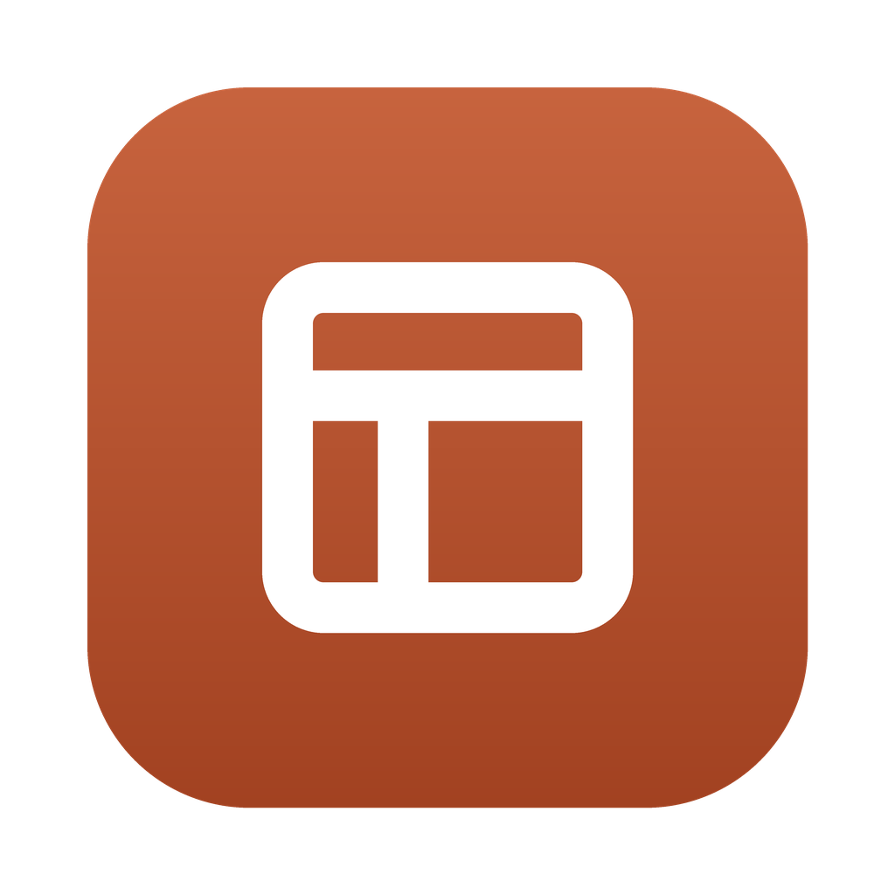
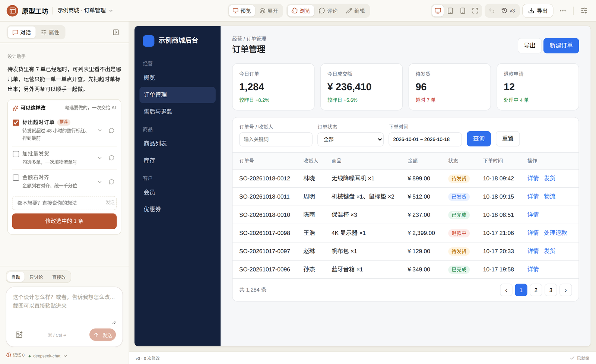
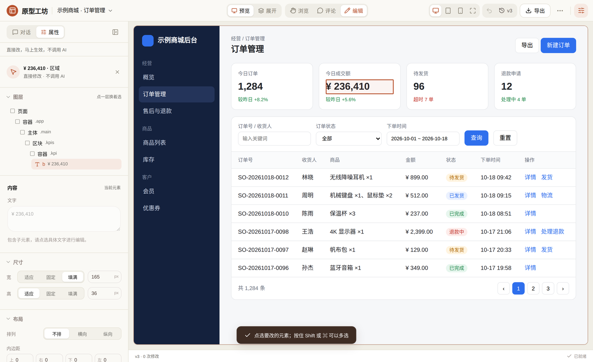
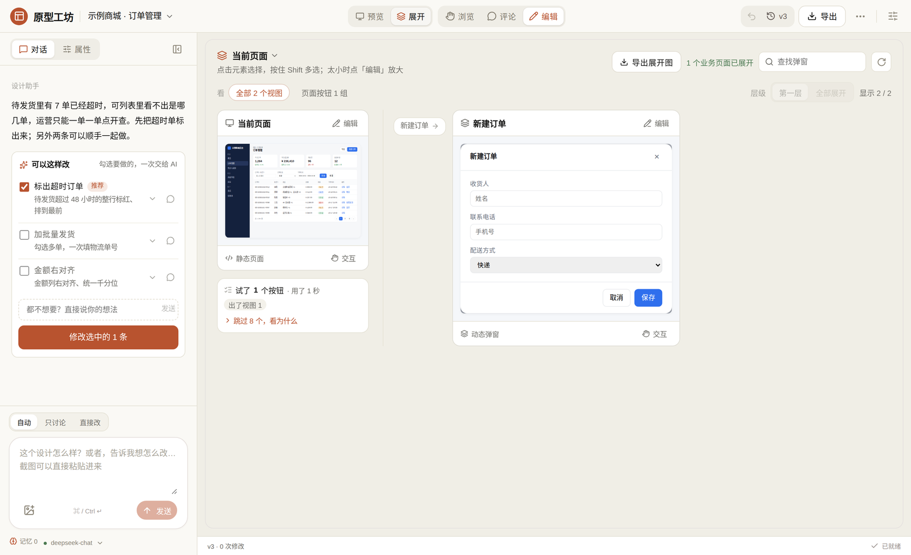
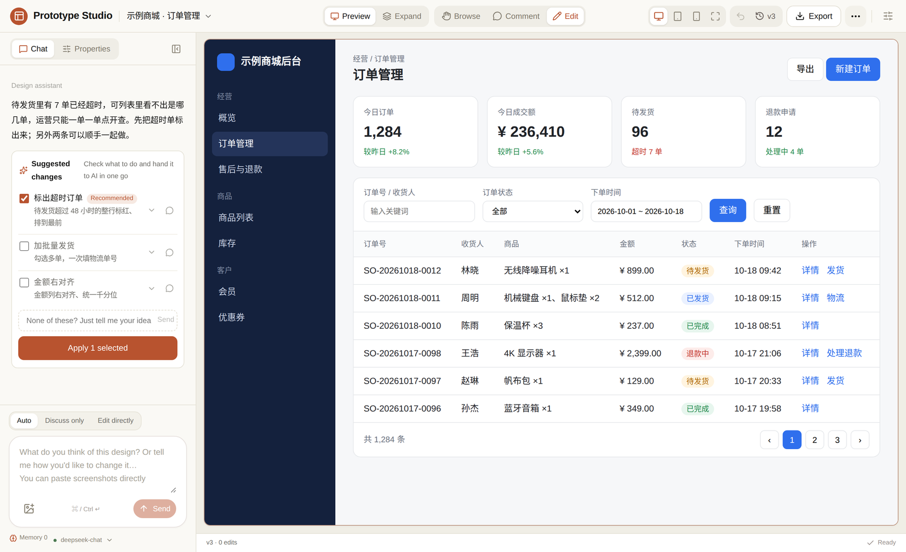

<div align="center">



# 原型工坊 · Prototype Studio

**用说话的方式做可点击的 HTML 原型。** 一句话起一版，在页面上点一下、圈一下告诉 AI 改哪里，
改完它自己把每个按钮点一遍检查，改错了随时退回。

本地运行 · 模型用你自己的 · 中文 / English

[下载](#下载安装) · [功能](#它能做什么) · [从源码运行](#从源码运行) · [自己打包](#自己打包) · [反馈](#反馈与联系) · [English](#english)



</div>

## 它能做什么

- **一句话起一版**：说「做个退款审核页面」，AI 先梳理业务（谁用、要看什么、要做什么操作），
  再把菜单、列表、筛选、弹窗搭出来，不是一张空壳；导入了带页面外壳的 skill 包，就照你们的外壳来搭。
- **指给它看再改**：在原型上**点一下**元素、**按住拖动圈一块**、或者**画几笔**写评论，AI 拿到的是准确的位置，
  不用在源码里猜。几条意见可以先记下，攒齐了一次交给它。
- **先聊清楚再动手**：问「这里还缺什么？」只讨论、不改文件，给你一张可勾选的建议清单，
  勾上要做的一次交给 AI；都不想要就直接写你的想法。
- **改完自己检查**：每次改动先过结构、脚本和启动检查才保存；改动大时会像用户一样把每页的按钮点一遍，
  发现报错、关不掉的弹窗、翻页串到别的页面这类问题，自动交回去修一轮。
- **不花 token 的直接修改**：切到「编辑」，选中元素就能改文字、颜色、字号、间距、宽高（适应 / 固定 / 填满），
  马上生效，不调用 AI。
- **一键展开所有弹窗**：「展开」把每个页面里能点开的弹窗、页签、子页面摊成一张图，评审时一眼看全，
  也能导出成一个 HTML 发给别人。
- **随时退回**：每次修改都是一个版本；AI 修改、手动微调、版本退回合成一条撤销时间线。
- **记得你的约定**：说过一次「以后表格都带斑马纹」，它会记下来，这个项目的所有页面都照这个来。
- **用你们公司的规范**：设计规范、组件库、skill 包都能导入，AI 照抄你们的结构，而不是每次自己发明一个。
- **中文 / English**：界面在「···」菜单里一键切换；AI 用你提问的语言回复。

| 直接改属性，不调用 AI | 展开这一页的所有弹窗 |
|---|---|
|  |  |

## 下载安装

到 [Releases](../../releases/latest) 下载：

| 系统 | 文件 | 安装 |
|---|---|---|
| macOS 11+（Apple 芯片） | `PrototypeStudio-版本号-macOS.dmg` | 打开后把「原型工坊」拖进「应用程序」 |
| Windows 10 / 11（64 位） | `PrototypeStudio-版本号-Windows-Setup.exe` | 双击安装，开始菜单和桌面会有图标 |
| Windows 免安装 | `PrototypeStudio-版本号-Windows-Portable.zip` | 解压后双击 `PrototypeStudio.exe` |

应用没有做开发者签名，**第一次打开**会被系统拦一下：

- **macOS**：提示「无法验证开发者」时，右键点应用 →「打开」；或到「系统设置 → 隐私与安全性」点「仍要打开」。
- **Windows**：提示「Windows 已保护你的电脑」时，点「更多信息」→「仍要运行」。

不用装 Python、Node 或别的环境。Windows 用系统自带的 Edge WebView2（Win11 都有，Win10 基本都有）。

### 第一次打开：绑定你自己的模型

应用里不带任何模型和密钥。第一次打开会弹出「模型设置」，填三样东西：

- **接口地址**：任何兼容 OpenAI Chat Completions 的服务都行，比如 DeepSeek、通义千问、智谱、豆包、OpenAI，或者公司内网的模型网关
- **模型名称**：服务商控制台里的模型名
- **API 密钥**

模型**必须支持工具调用（function calling）**，否则只能聊天、不能改页面。「保存并测试」会帮你确认。
要用截图理解，再勾上「能看图片」并选一个视觉模型。可以绑多个模型，在输入框下面一点就切换。

## 隐私

- 所有东西都在你电脑上：项目、版本、对话、记忆、模型设置。
  Mac 在 `~/Library/Application Support/原型工坊`，Windows 在 `%LOCALAPPDATA%\原型工坊`。卸载应用不会删它们。
- 除了你绑定的模型接口，不会把任何内容发到别处。
- API 密钥只存在本机配置里，不写进浏览器存储，也不写进原型文件；报错信息里出现密钥会被替换成 `[密钥]`。
- 安装包是空的：打包脚本会检查，确认没把打包人的项目、密钥、组件、skill 带进去。

## 从源码运行

需要 Python 3.10+ 和 Node.js 18+。

```bash
git clone https://github.com/ligaoruan-svg/prototype-studio.git
cd prototype-studio
cd frontend && npm ci && node scripts/build-esm.mjs . && cd ..   # 构建界面
python3 -m venv .venv && source .venv/bin/activate
pip install -e .
make dev            # 浏览器打开 http://127.0.0.1:5173
```

macOS 上也可以直接在访达里双击 `scripts/启动原型工坊.command`：第一次会自动建环境、装依赖、起服务并打开浏览器。

想用桌面窗口而不是浏览器：`pip install pywebview && python3 desktop/app.py`。

## 自己打包

| 想要 | 怎么做 |
|---|---|
| Mac 安装包 | 在 Mac 上双击 `scripts/打包Mac应用.command`，得到 `release/原型工坊-版本号.dmg` |
| Windows 安装包 | 在 Windows 上装好 Python 3.12（可选再装 [Inno Setup 6](https://jrsoftware.org/isdl.php)），双击 `scripts/打包Windows应用.bat` |
| 两个都要、只有 Mac | 双击 `scripts/上传GitHub打包.command`：代码传到你的 GitHub 仓库，GitHub Actions 同时打两个平台并下载回来 |
| 发一个新版本 | 推一个 `v*` 标签（如 `v6.1`），Actions 会打包并发到 Releases |

PyInstaller 不能跨系统打包，所以 Windows 版要么在 Windows 上打，要么交给 GitHub Actions。
打包流程见 `desktop/`：`app.py` 是桌面外壳（本机起服务 + 原生窗口），`release_check.py` 是发出去之前的检查。

## 目录结构

```text
backend/        FastAPI 服务：Agent 循环、精确补丁、两阶段提交、自检、记忆
frontend/       Vue 3 界面（src/components、src/lib、src/locales 翻译表）
prompts/        系统提示词和默认设计规范，可直接改，也可以在界面里编辑
desktop/        桌面应用：外壳、打包配置、安装程序、图标、GitHub Actions 配置
scripts/        双击就能用的脚本：启动浏览器版、打包 Mac / Windows、上传 GitHub 打包、开源发布
sample/         新建项目用的空白模板
docs/           设计记录和截图
data/           本机数据（不进版本库）
```

## 技术要点

- **精确补丁**：模型只返回局部操作，不返回整页 HTML；替换按原始源码区间进行，没涉及的源码一字不改。
- **两阶段提交**：修改先生成候选，通过结构、脚本语法和独立 iframe 启动检查后才保存成新版本；没过就保留上一版，
  并能在报错的那一版基础上让 AI 修。
- **自检**：保存后在后台把每个菜单页的按钮点一遍，检查报错、翻页串页、主按钮过多、表格被裁、弹窗关不掉、编号重复等，
  有问题自动交回去修一轮。
- **流式进度**：执行卡片显示的是人话，不出现工具名和选择器。

## 开发与测试

```bash
make test                                         # 前端 + 后端单元测试
python3 -m unittest discover -s backend/tests -t .
cd frontend && npm test
```

界面文案写的是中文原文，英文在 `frontend/src/locales/en.js`；新加的中文没有英文翻译时测试会报出来。
加一种语言 = 加一份 `locales/xx.js`，再在 `src/lib/i18n.js` 的 `LANGUAGES` 里登记。

## 反馈与联系

我是一名产品经理，这是我个人做的项目（[@ligaoruan-svg](https://github.com/ligaoruan-svg)）。天天画原型、改原型，受够了来回找人改页面，就做了这个工具。用着有问题、哪里不满意、想要什么功能，都欢迎告诉我，我来改：

- **提 Issue**：[在这里新建](../../issues/new)，报 bug、提建议都行。附上截图和你当时对 AI 说的那句话，我能更快定位
- **发邮件**：[rusnligao@gmail.com](mailto:rusnligao@gmail.com)

## 许可证

[AGPL-3.0](LICENSE)。可以自由使用、修改和再分发；修改后的版本分发出去或者做成网络服务给别人用，也要以同样的许可证公开源码。

---

## English

**Prototype Studio** turns conversation into clickable HTML prototypes. Describe a page and it drafts one inside a proper
app shell; click, circle or sketch on the prototype to show the AI exactly what to change; it checks its own work by
clicking through every button, and every change is a version you can roll back.

- Runs locally; bring your own model (any OpenAI Chat Completions–compatible API with function calling)
- Point-and-comment editing, a discuss-first mode with a pick-what-you-want suggestion list, and token-free direct style edits
- Self-test after each change (runtime errors, broken pagination, clipped tables, dialogs that won't close…) with an automatic fix round
- Expand view lays out every dialog, tab and sub-page on one board, exportable as a single HTML file
- Project memory, custom design guidelines, component libraries and skill packs
- UI in Chinese or English (switch in the ··· menu); the AI replies in the language you write in



**Install**: download the `.dmg` (macOS 11+, Apple silicon) or the Windows installer / portable zip from
[Releases](../../releases/latest). The apps are unsigned: on macOS right-click → Open the first time; on Windows click
"More info" → "Run anyway". On first launch, bind your own model (endpoint, model name, API key).

**From source**: see [从源码运行](#从源码运行) above — `pip install -e .`, build the frontend, then `make dev`.

**About**: built by a product manager ([@ligaoruan-svg](https://github.com/ligaoruan-svg)) who draws and revises prototypes every day. **Feedback**: something broken or not to your liking? [Open an issue](../../issues/new) or email [rusnligao@gmail.com](mailto:rusnligao@gmail.com) — I'll fix it.

Licensed under [AGPL-3.0](LICENSE).
